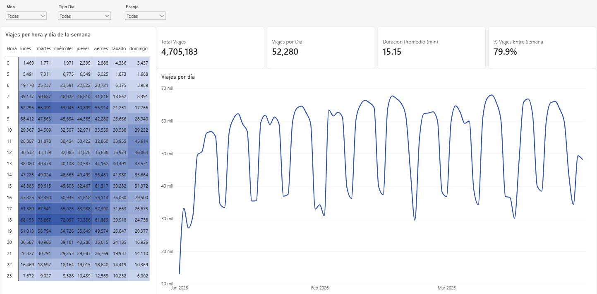
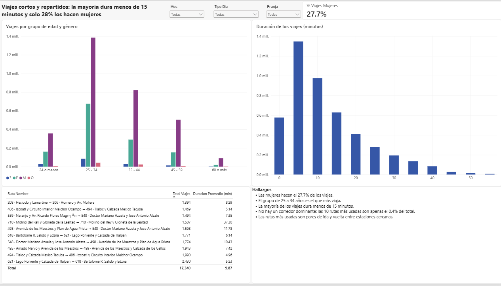
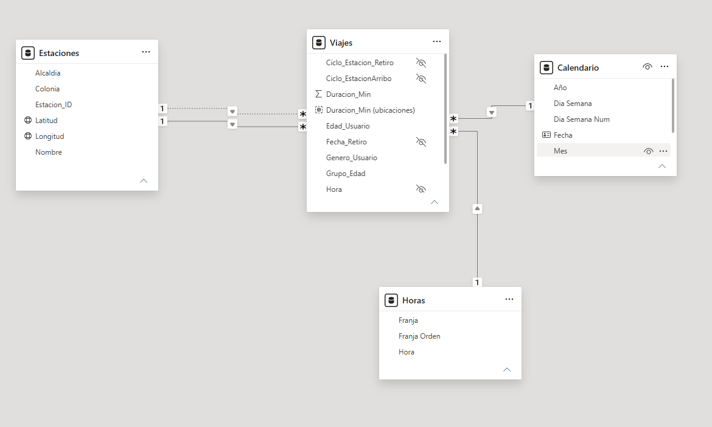

# ecobici-powerbi
Análisis de viajes de Ecobici CDMX en Power BI

# Ecobici CDMX: ¿dónde y cuándo faltan bicicletas?

Análisis de los viajes de Ecobici en Power BI para identificar en qué
estaciones y horarios faltan o sobran bicicletas.

**Estado:** en construcción. Modelo y medidas terminados; reporte en proceso.

## Pregunta de negocio

¿En qué estaciones y horarios debería Ecobici mover bicicletas para que no
falten ni sobren?

## Hallazgos preliminares

- **Uso diario:** en promedio se realizan 52,280 viajes por día.
- **Duración:** un viaje dura en promedio 15.2 minutos, y casi no cambia de
  un mes a otro (15.0 en enero, 15.2 en febrero y marzo).
- **Uso laboral:** el 79.9% de los viajes ocurre de lunes a viernes, aunque esos
  días son el 71% del periodo (64 de 90 días).
- **Estaciones que acumulan bicicletas:** tres estaciones contiguas concentran
  el mayor excedente del sistema.

| Estación | Salidas | Llegadas | Balance neto |
| --- | --- | --- | --- |
| 271-272 · Jesus Garcia y Carlos J. Meneses | 27,604 | 48,251 | +20,647 |
| 266-267 · Jesus Garcia y Carlos J. Meneses | 11,462 | 20,796 | +9,334 |
| 273-274 · Luis Donaldo Colosio y Jesus Garcia | 14,880 | 20,980 | +6,100 |

  Las tres están junto a la terminal de Buenavista (tren suburbano y metro).
  El filtro por franja horaria confirma que son viajes de conexión con el
  transporte masivo (ver "Flujo diario").

- **Estaciones que pierden bicicletas:** 376 estaciones tuvieron más salidas
  que llegadas en el trimestre. Las de mayor déficit:

| Estación | Salidas | Llegadas | Balance neto |
| --- | --- | --- | --- |
| 208 · Hesiodo y Lamartine | 29,686 | 25,129 | -4,557 |
| 237-238 · Andres Bello y George Eliot | 17,375 | 13,826 | -3,549 |
| 495 · Amado Nervo y Avenida de los Maestros | 16,610 | 13,251 | -3,359 |

- **Uso por mes:** marzo fue el mes con más viajes, 8.1% arriba de febrero.
  Febrero casi iguala a enero con tres días menos, por lo que tuvo el
  promedio diario más alto.

| Mes | Viajes | Variación mensual | Viajes por día |
| --- | --- | --- | --- |
| Enero | 1,524,681 | | 49,183 |
| Febrero | 1,528,014 | +0.2% | 54,572 |
| Marzo | 1,652,488 | +8.1% | 53,306 |

- **Horas pico entre semana:** el uso se concentra a las 8 de la mañana y a
  las 6 de la tarde. Los viajes iniciados de 7:00 a 8:59 y de 17:00 a 18:59
  suman el 31.5% de todos los viajes de lunes a viernes. El pico de la tarde
  (17.6%) es mayor que el de la mañana (13.9%). La hora con más viajes del
  trimestre es el martes a las 18:00, con 73,667.
- **Fin de semana:** el patrón cambia. No hay pico de entrada ni de salida;
  el uso sube despacio y alcanza su máximo al mediodía (domingo a las 12:00,
  46,864 viajes; sábado a las 14:00, 41,980). Un día de fin de semana tiene
  36,312 viajes en promedio, contra 58,767 de un día entre semana, y los
  viajes duran más: 17.3 minutos en promedio.
- **Viernes:** la tarde se adelanta. A las 15:00 hay casi tantos viajes
  (61,317) como a las 18:00 (61,869).
- **Horario:** no hay viajes entre la 1:00 y las 4:59, porque el servicio no
  opera de madrugada.

- **Flujo diario:** el balance se invierte entre la mañana y la tarde, lo que
  muestra un patrón de ida y vuelta al trabajo.

| Estación | Mañana (6:00 a 9:59) | Tarde (16:00 a 20:59) |
| --- | --- | --- |
| 271-272 · Jesus Garcia y Carlos J. Meneses (Buenavista) | -8,900 | +27,000 |
| 273-274 · Luis Donaldo Colosio y Jesus Garcia (Buenavista) | -8,800 | +13,000 |
| 014 · Av. Paseo de la Reforma y Rio de la Plata | +7,900 | -4,000 |

  En la mañana, Buenavista se vacía y las estaciones de Paseo de la Reforma y
  Polanco se llenan: la gente llega en transporte o metro y termina su trayecto en
  bicicleta hacia las zonas de oficinas. En la tarde ocurre lo contrario.

- **Asimetría:** a Buenavista llegan en la tarde muchas más bicicletas de las
  que salen de ahí en la mañana. Por eso acumula más de 20 mil bicicletas en
  el trimestre, y el poniente acumula el déficit.

- **Usuarios:** las mujeres hacen el 27.7% de los viajes. El grupo de 25 a 34
  años es el que más viaja, con cerca del doble de viajes que el de 35 a 44.
- **Duración:** la mayoría de los viajes dura menos de 15 minutos; el rango más
  frecuente es de 5 a 10 minutos y casi ninguno pasa de 45.
- **Rutas:** no hay un corredor dominante. Las 10 rutas más usadas suman 17,340
  viajes, el 0.4% del total. Varias aparecen en pares de ida y vuelta entre las
  mismas estaciones (621 ↔ 618, 494 ↔ 486, 548 ↔ 498), con viajes de 5 a 12
  minutos. La excepción es la 710 · Molino del Rey y Glorieta de la Lealtad,
  donde muchos viajes empiezan y terminan en la misma estación y duran 37
  minutos en promedio: son paseos, no traslados.

## Recomendación

Programar la redistribución según la hora, no solo por estación:

1. **Antes de las 16:00, liberar espacios en Buenavista.** Es la estación que
   más llegadas recibe en la tarde; si se llena, los usuarios no pueden
   devolver la bicicleta.
2. **Durante la noche, regresar bicicletas de Buenavista al poniente.** El
   excedente de Buenavista cubre de sobra sus salidas de la mañana, y el
   poniente (Polanco) es la zona que termina el día con faltantes.
3. **En la mañana, tener espacios libres sobre Paseo de la Reforma.** Son las
   estaciones que más bicicletas reciben en la hora de entrada al trabajo.

## Datos
Fuente: Datos abiertos de Ecobici (ecobici.cdmx.gob.mx/datos-abiertos)
Fuente: Diccionario de datos y cicloestaciones Ecobici (https://www.datos.cdmx.gob.mx/dataset/cicloestaciones-ecobici-nuevo-sistema)

- Periodo: enero a marzo de 2026
- Volumen: 4,707,285 viajes originales; 4,705,183 después de la limpieza

- Catálogo de cicloestaciones: se descarga en formato .dbf y se convirtió a
  Excel para cargarlo en Power BI

## Limpieza de datos
Se eliminaron 2,663 registros (0.06% del total) con estas reglas:

| Regla | Registros eliminados |
| --- | --- |
| Duración menor a 1 minuto o mayor a 180 minutos | 2,298 |
| Estación de retiro o de arribo vacía | 0 |
| Edad fuera del rango de 16 a 90 años | 289 |
| Viajes iniciados el 31 de diciembre de 2025 | 76 |

Otras transformaciones en Power Query:

- Fechas leídas con configuración regional Español (México), porque vienen en
  formato día/mes/año.
- Identificadores de estación tratados como texto, para conservar los ceros a
  la izquierda (`059`) y los identificadores dobles (`271-272`).
- Columnas calculadas: duración en minutos, hora del día, grupo de edad y ruta.
- Columna calculada en DAX `Ruta Nombre`, que muestra la ruta con los nombres
  de las estaciones de origen y destino.

## Modelo de datos

Esquema de estrella con una tabla de hechos y tres dimensiones:

| Tabla | Tipo | Contenido |
| --- | --- | --- |
| Viajes | Hechos | Un renglón por viaje |
| Estaciones | Dimensión | Identificador, nombre, colonia, alcaldía, latitud y longitud |
| Calendario | Dimensión | Un renglón por día: año, mes, día de la semana y tipo de día |
| Horas | Dimensión | 24 renglones: hora y franja horaria |

`Estaciones` se relaciona dos veces con `Viajes`: por estación de retiro
(relación activa) y por estación de arribo (relación inactiva, que se activa
en la medida `Llegadas` con `USERELATIONSHIP`).

<!-- PENDIENTE: captura de la vista de modelo

-->

## Medidas DAX

El reporte usa 9 medidas principales y 3 de apoyo. La principal es `Balance Neto` (llegadas menos
salidas): un valor negativo indica que la estación pierde bicicletas y uno
positivo, que las acumula. Todas están documentadas en
[dax/medidas.md](dax/medidas.md).

## Limitaciones

- El análisis cubre 3 meses, por lo que no refleja estacionalidad.
- El balance neto mide el flujo de viajes, no cuántas bicicletas había en
  cada estación.
- 40 salidas y 18 llegadas corresponden a estaciones que no aparecen en el
  catálogo de cicloestaciones y se muestran sin nombre.
- Los archivos mensuales parecen organizarse por fecha de arribo, por lo que
  faltan los viajes que iniciaron el 31 de marzo y terminaron el 1 de abril.

## Herramientas
Power BI Desktop, Power Query, DAX

## Cómo reproducirlo

1. Descarga los CSV de viajes desde la fuente y colócalos en `data/raw/viajes/`.
2. Descarga el catálogo de cicloestaciones (ver `data/README.md`).
3. Abre `report/ecobici.pbix` y actualiza la ruta de la carpeta de datos.
4. Actualiza los datos.